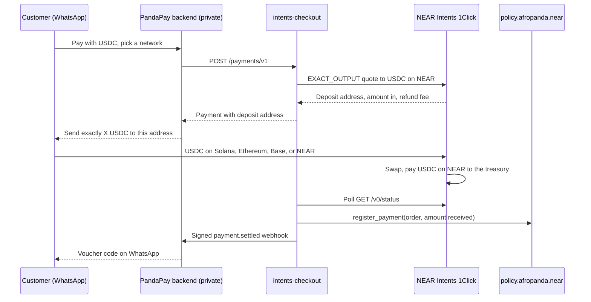

# Panda Pay Africa — Intents Checkout

> Built at NEAR HACKATHON (1–14 Nov 2026). Tracks: `realworld`, `business`, `security`.

Customers pay for WhatsApp orders in USDC from another chain. NEAR Intents (1Click) swaps it into USDC on NEAR for the merchant. Every settled payment is recorded on a NEAR contract that caps refunds of that payment.

## Live on NEAR mainnet

| | |
| --- | --- |
| Spending guard | [`policy.afropanda.near`](https://nearblocks.io/address/policy.afropanda.near) |
| Code hash | `HoV3wZrvHBAnCmVMYiQ3tpnTh4vTwUMT1CiBnBDQm56g` (release build of `checkout-policy` from this repo) |
| Deploy and `new`, one transaction | [`MmW32gotC2ioZxmGgM38BuTupoqg8PjjTRUsGdBf9ty`](https://nearblocks.io/txns/MmW32gotC2ioZxmGgM38BuTupoqg8PjjTRUsGdBf9ty) |
| Owner | `afropanda.near` |
| Operator | `operator.afropanda.near`. The checkout service signs with a function-call key that can only call `register_payment`, `mark_fulfilled`, `request_refund`, `request_payout`, `execute_refund`, and `execute_payout` on the guard |
| Token | Native USDC on NEAR (`17208628f84f5d6ad33f0da3bbbeb27ffcb398eac501a31bd6ad2011e36133a1`) |
| Caps | 2 USDC per request, 5 USDC per UTC day |
| Access keys on the contract account | None. The key was deleted in [`BWyDqNbP…`](https://nearblocks.io/txns/BWyDqNbPodeGex7Fqv2zNd25tETDMCzBu5r5X2xJcTEG), so nobody can replace the code or move funds except through the contract's own rules |

Real WhatsApp payments recorded on the guard:

| Payment | What happened | Transaction |
| --- | --- | --- |
| `562d5700…` | 1 USDC paid on Solana, settled, `register_payment` | [`4R6yX8C9…`](https://nearblocks.io/txns/4R6yX8C9Eu8Y18kYdfKGmu6BQezANABF9EMKAHDrz6Bd) |
| `09880c5c…` | 1.031 USDC paid on Solana, 1 USDC settled, `register_payment` | [`3xtavfaq…`](https://nearblocks.io/txns/3xtavfaqLBUNiBwPASZeVY4S8m1Cqm1vzw9m8G1QeXdU) |

The guard then ran against those real orders. No USDC moved in these steps: a request only reserves an amount, and only `execute_refund` sends it.

| Step | Signer | Result | Transaction |
| --- | --- | --- | --- |
| Refund 0.5 USDC of `09880c5c…` | operator | Approved, request 1 | [`ApCeweC4…`](https://nearblocks.io/txns/ApCeweC4RTjQV5WGZjjvnnw5aWJVq3ohWLfwkKkFw9w9) |
| Refund another 0.6 USDC (0.5 + 0.6 > 1.0 received) | operator | Failed: `E_AMOUNT_EXCEEDS_RECEIVED` | [`J6oLeaQR…`](https://nearblocks.io/txns/J6oLeaQRWc4HqNjDfmVyiK6N3FX9NmzLRpj58bGc2jfM) |
| Refund 0.2 USDC (under the 2 USDC cap) | operator | Approved, request 2 | [`AePcxuUY…`](https://nearblocks.io/txns/AePcxuUYRS9h4vm7bY3mFwUFQ3aHQwWJeAAFaBGXxU4t) |
| Mark `09880c5c…` fulfilled | operator | Order fulfilled | [`3WZYCnD7…`](https://nearblocks.io/txns/3WZYCnD7k1LeHKkZxQXZtB5vPk4NPgSvCXC3B8HxArKh) |
| Refund 0.1 USDC of the fulfilled order | operator | Failed: `E_FULFILLED` | [`9WCjYRfp…`](https://nearblocks.io/txns/9WCjYRfpTWrj4CRdUMraS5sTCAGYBiiohEUwHAumQe4G) |
| Lower the per-request cap to 0.1 USDC | owner | Caps changed | [`4xL48pnp…`](https://nearblocks.io/txns/4xL48pnprkF6ZNZqYav4eyPvcWnTnxEncRvfWAf7YPkh) |
| Refund 0.2 USDC of `562d5700…` | operator | Escalated, request 3 | [`GSE42xLe…`](https://nearblocks.io/txns/GSE42xLemZBMQcbUtEvjGfxsDWwR36Z96ya8GfGhDZcK) |
| Reject request 3 | owner | Rejected; the order's reservation is back to 0 | [`GVjrGrA3…`](https://nearblocks.io/txns/GVjrGrA3V1dwBWkWgWHqF55eUkf7R4urWwCUiisHhuqm) |
| Restore caps to 2 and 5 USDC | owner | Caps changed | [`3urgvHzX…`](https://nearblocks.io/txns/3urgvHzXVCEHjpXrnWSYYJY3pVXmgZXrh3yanh8oxzvQ) |

Read one back:

```bash
near contract call-function as-read-only policy.afropanda.near get_order \
  json-args '{"order_ref":"09880c5c-4d2b-44df-b29c-c0c7221092f2"}' network-config mainnet now
```

## The problem

[Panda Pay Africa](https://www.pandapay.africa) is an agentic payments solution for gamers: customers chat on WhatsApp to buy gaming gift cards such as PlayStation, Xbox, and Steam, and the code is delivered in the same chat. It launched publicly a week ago and already has almost 200 users, most of them active gamers in West Africa. Customers pay by bank transfer into a Nigerian naira account, which only works for players in Nigeria.

Players in neighbouring countries such as Ghana are asking for the service, and Panda Pay Africa plans to expand to them. A naira bank transfer does not work for them, but USDC does: it is worth the same in Accra as in Lagos. The difficulty is that each customer holds USDC on a different chain, and the merchant still needs to cap how much of it can be sent back out as refunds.

This repository solves both. The customer pays in USDC from Solana, Ethereum, Base, or NEAR; NEAR Intents settles it as USDC on NEAR; and every settled payment is recorded on a NEAR contract that limits its refunds.

## The business

Panda Pay Africa's WhatsApp backend is private and existed before the hackathon; it already takes naira bank transfers. This repository is the USDC rail that backend now calls.

## How it works



1. The customer picks a network: USDC on Solana, Ethereum, Base, or NEAR.
2. `intents-checkout` asks 1Click for an exact-output quote: the merchant gets exactly the order amount in USDC on NEAR. The customer is asked for the quoted amount plus 1Click's refund fee, so a failed swap can still be returned.
3. The service polls 1Click. When the swap succeeds, it calls `register_payment` on the guard. Only after that call succeeds is the payment marked `SETTLED` and the signed webhook queued.
4. A short, late, or failed deposit is returned by 1Click to the merchant's refund address on the origin chain. The customer is told on WhatsApp. The guard is not involved, because no USDC reached the treasury.

## What the guard enforces

Rules live in `checkout-policy/src/policy.rs` (pure functions) and `checkout-policy/src/lib.rs` (contract). Every row names the test that proves it.

| Rule | Test |
| --- | --- |
| A refund at or under the per-request cap is approved; above it, escalated to the owner | `above_the_per_tx_cap_escalates`, `an_in_cap_refund_is_approved_and_an_over_cap_refund_is_escalated` |
| Going past the daily cap escalates | `going_past_the_daily_cap_escalates` |
| A refund can never exceed received − refunded − reserved | `refund_up_to_received_minus_refunded_minus_reserved_is_allowed`, `a_refund_above_the_remainder_is_rejected` |
| No refund after the order is fulfilled | `refund_after_fulfilment_is_rejected`, `a_fulfilled_order_cannot_be_refunded` |
| Payouts only go to allowlisted payees | `a_payout_to_an_unknown_payee_is_rejected` |
| An escalated request cannot be executed until the owner approves it, and only the owner can | `an_escalated_refund_cannot_be_executed`, `the_operator_cannot_approve` |
| One approved request makes one USDC transfer | `an_approved_refund_creates_one_usdc_transfer_and_a_repeat_does_not` |
| A failed transfer releases its reservation | `a_refund_failure_callback_releases_the_reservation_and_cannot_execute_again` |
| Pause stops new payments and refunds | `register_payment_rejects_while_paused`, `a_refund_is_rejected_while_paused` |
| Only the operator records payments; only the owner changes caps | `register_payment_rejects_a_non_operator`, `the_operator_cannot_set_caps` |
| Transfer callbacks only come from the contract itself | `a_callback_from_another_account_is_rejected` |

`checkout-policy/tests/sandbox.rs` runs the same flow against a real NEAR sandbox with a mock USDC token.

## Limits

- Escalated requests are approved by one owner account, `afropanda.near`. It is not a multisig.
- The operator chooses the 1Click deposit address when it executes a refund. The service checks that the quote pays the order's refund address. The contract cannot see 1Click.
- No refund has been sent through the guard back to a customer's chain on mainnet.
- The live treasury is `afropanda.near`, so settled USDC is not held by the guard contract yet.
- The PandaPay backend does not report voucher delivery to checkout yet, so `mark_fulfilled` is called by hand.
- The contract cannot be upgraded. A fix means a new deploy to a new account.
- Payments move to `RETURNED` with the right status, but `refundedAmount` does not yet show what 1Click sent back.
- The reference agent in `checkout-agent/` is not part of `docker compose`. The live WhatsApp flow is the PandaPay backend.

## Try it (do X → see Y)

`docker compose up` starts Postgres, a webhook sink that prints every webhook, and `intents-checkout` in fake mode. Fake mode stands in for 1Click and NEAR: no keys, no funds, and every quote returns the same `amountIn`. If port 3000 is taken on your machine, change the `ports` line in `docker-compose.yml`.

```bash
docker compose up --build
```

Wait for `merchant api key judge-merchant-key` and `listening` in the log. In a second terminal:

```bash
B=http://localhost:3000
K='x-api-key: judge-merchant-key'
```

**1. Health.**

```bash
curl -s $B/health/ready
```

```json
{"status":"ready","checks":{"config":"ok","postgres":"up"}}
```

**2. List payable assets.** Three in fake mode; the first is USDT on Tron.

```bash
curl -s $B/assets/v1 -H "$K"
```

```json
{"assetId":"nep141:tron-d28a265909efecdcee7c5028585214ea0b96f015.omft.near","symbol":"USDT","blockchain":"tron","decimals":6, ...}
```

**3. Create a payment** for 1 USDC on NEAR, paid from USDT on Tron.

```bash
curl -s -X POST $B/payments/v1 -H "$K" -H 'content-type: application/json' \
  -d '{"merchantOrderId":"PPA-1","amountOut":"1000000","originAsset":"nep141:tron-d28a265909efecdcee7c5028585214ea0b96f015.omft.near","refundTo":"TJudgeRefundAddress"}'
```

```json
{"paymentId":"<id>","merchantOrderId":"PPA-1","status":"AWAITING_DEPOSIT","amountOut":"1000000","amountIn":"1010203","minAmountIn":"1000101","refundFee":"2400","depositAddress":"TFakeDeposit…", ...}
```

```bash
P=<paymentId from the response>
```

**4. Wait about 5 seconds, then read it.** The fake deposit has settled.

```bash
curl -s $B/payments/v1/$P -H "$K"
```

```json
{"paymentId":"<id>","status":"SETTLED","settledAmount":"1000000","refundedAmount":"0", ...}
```

The webhook sink prints the `payment.settled` body. Each delivery carries an HMAC-SHA256 signature in `x-checkout-signature`.

**5. Refund it in full.**

```bash
curl -s -X POST $B/payments/v1/$P/refunds -H "$K" -H 'content-type: application/json' \
  -d '{"amount":"1000000","reason":"customer returned the order"}'
```

```json
{"refundId":"<id>","paymentId":"<id>","status":"COMPLETED","amount":"1000000","reason":"customer returned the order", ...}
```

HTTP 202. The sink prints `refund.completed`.

**6. Try to refund again.**

```bash
curl -s -X POST $B/payments/v1/$P/refunds -H "$K" -H 'content-type: application/json' \
  -d '{"amount":"1000000","reason":"second try"}'
```

```json
{"refundableAmount":"0","type":"…/problems/refund-not-allowed","title":"Refund not allowed","status":409}
```

**7. Report fulfilment on a new payment, then try to refund it.** Create `PPA-2` as in step 3 and wait for `SETTLED`.

```bash
P2=<paymentId of PPA-2>
curl -s -X POST $B/payments/v1/$P2/fulfilment -H "$K"
```

HTTP 200 with `"fulfilledAt"` set.

```bash
curl -s -X POST $B/payments/v1/$P2/refunds -H "$K" -H 'content-type: application/json' \
  -d '{"amount":"500000","reason":"late"}'
```

HTTP 409, `refund-not-allowed`.

**8. No key, no data.**

```bash
curl -s $B/payments/v1/$P
```

```json
{"type":"…/problems/unauthorized","title":"Unauthorized","status":401}
```

## Projects

| Project | What it is |
| --- | --- |
| `intents-checkout/` | Payments service: 1Click quotes, status polling, settlement, signed webhooks, refunds, payouts. API in `intents-checkout/openapi.yaml` |
| `checkout-policy/` | NEAR contract: spending guard for refunds and payouts |
| `checkout-agent/` | Reference WhatsApp agent. Holds no keys and cannot change where money goes. See `BENCHMARKS.md` |

## NEAR primitive → file map

| Primitive | Path |
| --- | --- |
| Account and contract | `checkout-policy/src/lib.rs` |
| Money rules | `checkout-policy/src/policy.rs` |
| Cross-contract USDC transfer (NEP-141 `ft_transfer`) with a callback | `execute_refund` and `execute_payout` in `checkout-policy/src/lib.rs` |
| Function-call access key for the operator | `intents-checkout/src/adaptors/near-rpc/rpc-policy-ledger.ts` |
| NEAR Intents 1Click quote and status | `intents-checkout/src/adaptors/one-click/` |
| Agent chat | `checkout-agent/src/domain/conversation/` |

## Tests and CI

CI (`.github/workflows/ci.yml`) runs on every pull request.

| Project | Command | Result |
| --- | --- | --- |
| `intents-checkout` | `npm run test:unit -w intents-checkout` | 127 passed |
| `intents-checkout` | `npm run test:functional -w intents-checkout` (needs `DATABASE_URL`) | 37 passed |
| `checkout-agent` | `npm run test:unit`, `test:functional`, `test:adversarial` in `checkout-agent/` | 13, 20, 3 passed |
| `checkout-policy` | `cargo test --lib` in `checkout-policy/` | 67 passed |
| `checkout-policy` | `cargo test` (adds the NEAR sandbox test), `cargo clippy --all-targets -- -D warnings`, wasm release build | Run in CI |

## Libraries

Names and version ranges are copied from the manifests. The root `package.json` declares no libraries.

`intents-checkout/package.json` dependencies: drizzle-orm ^0.45.4, fastify ^5.12.8, near-api-js 7.5.3, pg ^8.23.1, pino ^10.4.0, zod ^3.25.76.

`intents-checkout/package.json` devDependencies: @eslint/js ^10.0.1, @types/node ^26.6.6, @types/pg ^8.23.1, drizzle-kit ^0.31.11, eslint ^10.14.0, tsx ^4.23.15, typescript ^6.0.3, typescript-eslint ^8.72.1, vitest ^4.1.12.

`checkout-agent/package.json` dependencies: fastify ^5.12.8, zod ^3.25.76.

`checkout-agent/package.json` devDependencies: @eslint/js ^10.0.1, @types/node ^26.6.6, eslint ^10.14.0, typescript ^6.0.3, typescript-eslint ^8.72.1, vitest ^4.1.12.

`checkout-policy/Cargo.toml` dependencies: near-sdk 5.

`checkout-policy/Cargo.toml` dev-dependencies: near-sdk 5 (feature `unit-testing`), near-workspaces 0.24, tokio 1 (features `macros`, `rt-multi-thread`), anyhow 1, serde_json 1.

## AI-generated code

Parts of this repository were written with AI coding agents and reviewed by a person.

## License

See `LICENSE`.
